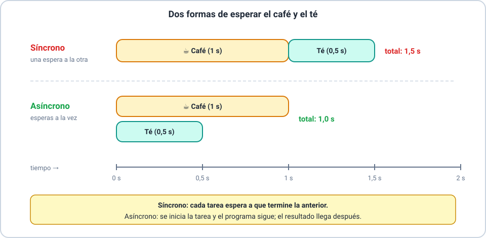
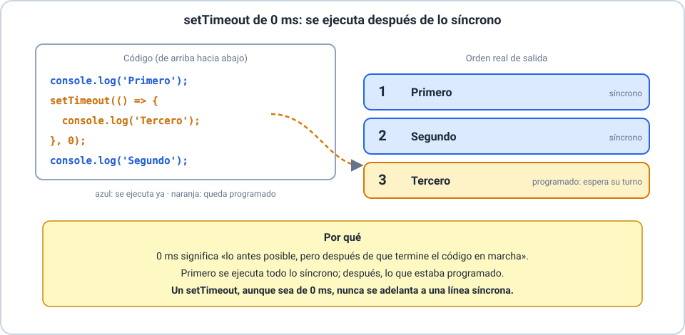
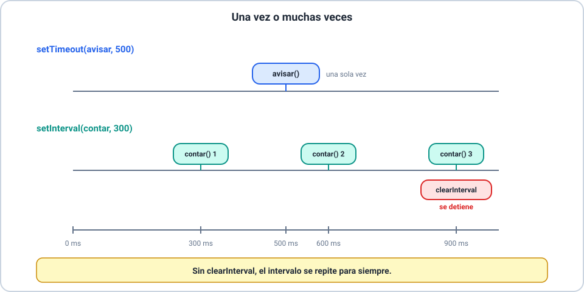

# 📚 Explicación conceptual — Asincronía y funciones callback

Hasta ahora, tus programas hacían una cosa después de otra y esperaban cada resultado. Pero el mundo real no espera: un café tarda en prepararse, una página tarda en cargar, un cliente hace clic cuando quiere. En este módulo aprendés **qué es la asincronía**, por qué JavaScript **no se queda esperando** y cómo usar **funciones callback** (funciones que le pasás a otra para que las llame más tarde). Los ejemplos siguen con la tienda ficticia **«Aroma»** de las Clases 01 a 03, ahora con pedidos que se validan, se cobran, se preparan y se entregan.

La clase se dicta en **dos sesiones**: la **sesión 1** cubre los bloques 1, 3 y 4 (asincronía, JavaScript no bloqueante y modelo de ejecución) y la **sesión 2**, los bloques 2 y 5 (callbacks y gestión de tareas asíncronas). Por eso, en este archivo, los bloques aparecen en ese orden —**1, 3, 4, 2, 5**—: primero el problema y después la herramienta. Cada bloque conserva su número del temario.

Resultados de aprendizaje de la clase:

- **RA-1**: explicar qué es la asincronía y distinguir una tarea síncrona de una asíncrona.
- **RA-2**: explicar la diferencia entre bloqueante y no bloqueante.
- **RA-3**: explicar por qué lo asíncrono es importante en JavaScript.
- **RA-4**: describir el orden de ejecución (pila, cola y bucle de eventos) y predecir el orden de las salidas.
- **RA-5**: definir y usar una función callback, síncrona o asíncrona.
- **RA-6**: programar tareas con `setTimeout`, `setInterval` y eventos, y cancelarlas.
- **RA-7**: recibir el resultado de una tarea asíncrona con un callback, con el patrón «error primero».
- **RA-8**: encadenar tareas con callbacks y reducir el infierno de callbacks con funciones con nombre.
- **RA-9**: combinar lo aprendido en un problema de la tienda.

## 🗒️ Glosario

| Término | Equivalente |
|---|---|
| *synchronous* / *asynchronous* | síncrono (una tarea espera a la anterior) / asíncrono (el resultado llega después) |
| *blocking* / *non-blocking* | bloqueante (detiene el programa) / no bloqueante (el programa sigue) |
| *thread* | hilo de ejecución |
| *call stack* | pila de llamadas |
| *task queue* | cola de tareas |
| *event loop* | bucle de eventos |
| *callback* | función de retrollamada: una función que se le pasa a otra para que la llame después |
| *timer* | temporizador |
| *event* | evento (algo que ocurre en la página, como un clic) |
| *error-first callback* | callback «error primero» (el primer parámetro es el error) |
| *callback hell* | infierno de callbacks (callbacks anidados en exceso) |

> 📌 **Origen de la información.** El orden de las salidas de **todos** los ejemplos se obtuvo **ejecutando el código en el navegador** (Chrome) y contrastándolo con otro motor (Node.js) cuando no depende del navegador. Las descripciones siguen la terminología de MDN Web Docs y de la especificación HTML. Los **tiempos son aproximados**: `setTimeout` garantiza *como mínimo* ese tiempo; lo que importa es el **orden**. Los **mensajes de error** aparecen en **inglés**, porque así los entrega el navegador; el texto los traduce.
>
> 🚫 **Lo que queda para más adelante.** No usamos `Promise`, `async`/`await`, `fetch`, `try`/`catch`, clases, `call`/`apply`/`bind`, recursión ni `map`/`reduce`. Las promesas y `async`/`await` son justamente la respuesta al infierno de callbacks y se estudian en el módulo siguiente.

---

## ⏳ ¿Qué es la asincronía?

### 🧭 1 · ¿Qué es asincronía?

*Resultados de aprendizaje: RA-1*

> 🔗 **Ejemplos de este concepto**
>
> - [Ejemplo 01 — Todo en orden: el código síncrono](01-sincrono-paso-a-paso.md): tareas síncronas: una espera a la otra
> - [Ejemplo 02 — Lo asíncrono no se queda esperando](02-asincrono-con-temporizador.md): una tarea asíncrona: el programa sigue
> - [Ejemplo 03 — Primero lo síncrono, después lo programado](03-orden-de-ejecucion.md): el orden de salida con un temporizador

#### 🌍 Contexto

En una cafetería, el cajero puede quedarse mirando la máquina hasta que el café esté listo, o tomar el pedido siguiente mientras tanto. Son dos formas de manejar el tiempo.

#### 💡 Concepto

Una tarea es **síncrona** si la siguiente espera a que termine; es **asíncrona** si se pone en marcha y el programa continúa, y su resultado llega **después**.

#### 📖 Explicación

- **Síncrono = en fila.** Cada instrucción espera a la anterior; el orden de ejecución es el orden de escritura (Ejemplo 01).
- **Asíncrono = «avisame cuando termine».** Se inicia la tarea y el programa sigue; cuando la tarea termina, se ejecuta algo (Ejemplo 02).
- **El orden de salida puede no ser el de escritura.** Un mensaje escrito en medio puede aparecer al final (Ejemplo 03).
- **Por qué existe:** hay tareas que tardan (esperar un tiempo, un clic, una respuesta de la red) y no conviene detener todo mientras tanto.
- **Lo que viene después:** cómo usa JavaScript este modelo (bloque 3) y cómo se escribe «qué hacer cuando termine» (bloque 2).

---

## 🌐 Asincronía en JavaScript

### 🧭 3 · Asincronía en JavaScript

*Resultados de aprendizaje: RA-1, RA-3*

> 🔗 **Ejemplos de este concepto**
>
> - [Ejemplo 02 — Lo asíncrono no se queda esperando](02-asincrono-con-temporizador.md): el temporizador: la forma más simple de asincronía
> - [Ejemplo 03 — Primero lo síncrono, después lo programado](03-orden-de-ejecucion.md): `setTimeout` de 0 ms y el orden

#### 🌍 Contexto

JavaScript se creó para las páginas web, donde casi todo ocurre «cuando algo pasa»: un clic, una respuesta, un tiempo cumplido.

#### 💡 Concepto

En JavaScript, las tareas que **esperan** (tiempo, eventos, red) son **asíncronas**: se registran y el programa continúa; su resultado llega después a una función.

#### 📖 Explicación

- **El motor ejecuta tu código en un solo hilo:** una instrucción a la vez.
- **Las esperas las gestiona el navegador** (o el entorno), no tu código.
- **Cuando una espera termina,** el navegador avisa ejecutando la función que dejaste registrada.
- **Los tres subtemas siguientes** responden qué es lo asíncrono, por qué importa y qué significa «no bloqueante».

### 🧭 3.1 · Asincronía en JavaScript — ¿Qué es asíncrono?

*Resultados de aprendizaje: RA-1, RA-4*

> 🔗 **Ejemplos de este concepto**
>
> - [Ejemplo 02 — Lo asíncrono no se queda esperando](02-asincrono-con-temporizador.md): un `setTimeout` de 1 s: el programa sigue
> - [Ejemplo 03 — Primero lo síncrono, después lo programado](03-orden-de-ejecucion.md): orden de salida: `Primero`, `Segundo`, `Tercero`
> - [Ejemplo 05 — Esperar sin bloquear](05-no-bloqueante-con-temporizador.md): dos esperas a la vez: termina primero la más corta

#### 🌍 Contexto

Marcos programó un aviso de 0 ms y salió después de una línea escrita más abajo. ¿Por qué?

#### 💡 Concepto

Una operación **asíncrona** en JavaScript no detiene el programa: deja una función para ejecutar después y sigue con la línea siguiente.

#### 📖 Explicación

- **`setTimeout(función, ms)`** es el ejemplo más simple: ejecuta la función **más tarde**, pasados los milisegundos.
- **0 ms no es «ahora»:** es «después de lo que se está ejecutando». Todo el código síncrono va primero (Ejemplo 03).
- **El orden lo determina el instante en que vence cada tarea,** no el orden en que se escribieron (Ejemplo 05).
- **Los tiempos no son exactos:** son un mínimo. Para razonar, anotá el instante en que vence cada temporizador y ordená.
- **Para entrenar:** el Ejemplo 09 es un reto de predicción con temporizadores anidados.

### 🧭 3.2 · Asincronía en JavaScript — ¿Por qué lo asíncrono es tan importante en JavaScript?

*Resultados de aprendizaje: RA-3, RA-4*

> 🔗 **Ejemplos de este concepto**
>
> - [Ejemplo 06 — La página que se congela](06-pagina-congelada.md): la página que se congela y la que no
> - [Ejemplo 07 — Un solo hilo: una tarea a la vez](07-un-solo-hilo.md): un solo hilo: las tareas se turnan
> - [Ejemplo 08 — La pila, la cola y el bucle de eventos](08-pila-cola-y-bucle.md): pila, cola y bucle de eventos
> - [Ejemplo 09 — Predecí el orden](09-predecir-el-orden.md): reto: predecir el orden

#### 🌍 Contexto

Si JavaScript esperara sin más, cada botón lento congelaría toda la página. Para evitarlo, usa un modelo con tres piezas.

#### 💡 Concepto

JavaScript ejecuta tu código en **un solo hilo**; por eso necesita lo asíncrono: para que las esperas largas no impidan atender clics, escribir o desplazarse.

#### 📖 Explicación

- **Un solo hilo:** una tarea a la vez, completa, en orden de llegada (Ejemplo 07).
- **Pila de llamadas:** lo que se está ejecutando ahora (el código síncrono).
- **Cola de tareas:** las funciones que ya están listas (un temporizador vencido, un clic) y esperan turno.
- **Bucle de eventos:** cuando la pila queda vacía, toma la primera tarea de la cola y la ejecuta (Ejemplo 08).
- **Consecuencia:** si una tarea ocupa la pila mucho tiempo, todo lo demás espera (Ejemplo 06).
- **Es un modelo para razonar,** no un reglamento de cada navegador: existen otras colas con más prioridad, que veremos más adelante.

### 🧭 3.3 · Asincronía en JavaScript — Lenguaje no bloqueante

*Resultados de aprendizaje: RA-2, RA-3*

> 🔗 **Ejemplos de este concepto**
>
> - [Ejemplo 04 — Un bucle largo bloquea todo](04-bloqueante-un-bucle-largo.md): un bucle largo bloquea al temporizador
> - [Ejemplo 05 — Esperar sin bloquear](05-no-bloqueante-con-temporizador.md): esperar sin bloquear
> - [Ejemplo 06 — La página que se congela](06-pagina-congelada.md): botón que bloquea frente a botón que no

#### 🌍 Contexto

Un lenguaje o una operación puede **bloquear** (el programa se detiene hasta que termina) o **no bloquear** (el programa sigue).

#### 💡 Concepto

JavaScript es un lenguaje **no bloqueante** en sus operaciones de espera: las delega al entorno y recibe el aviso después; pero **tu propio código sí puede bloquear** si ocupa el hilo con trabajo largo.

#### 📖 Explicación

- **No bloqueante:** `setTimeout`, los eventos y las peticiones de red no detienen el programa (Ejemplo 05).
- **Bloqueante:** un bucle largo, o una operación síncrona lenta, ocupa el hilo y retrasa **todo**: clics, temporizadores, el dibujo de la página (Ejemplo 04).
- **Efecto visible:** una página que no responde (Ejemplo 06).
- **Cómo evitarlo:** no ocupar el hilo con tareas largas; usar tareas asíncronas para esperar.
- **Matiz:** «no bloquea» no significa que el código corra en paralelo; solo que la espera no detiene el hilo.

---

## ⚖️ Bloqueantes o no bloqueantes

### 🧭 4 · Lenguajes Bloqueantes o No Bloqueantes

*Resultados de aprendizaje: RA-2*

> 🔗 **Ejemplos de este concepto**
>
> - [Ejemplo 10 — Dos modelos de cafetería](10-bloqueante-o-no-bloqueante.md): dos modelos de cafetería, en código

#### 🌍 Contexto

No todos los lenguajes manejan la espera igual. La diferencia afecta cuánto aprovechan el tiempo y cuán fácil es leer el código.

#### 💡 Concepto

En un modelo **bloqueante** cada operación lenta detiene el programa hasta terminar; en un modelo **no bloqueante** el programa continúa y recibe el resultado después.

#### 📖 Explicación

- **Bloqueante:** simple de leer (el orden de ejecución es el de escritura), pero la espera de una tarea retrasa a las demás.
- **No bloqueante:** aprovecha mejor el tiempo y no congela la interfaz, pero exige pensar en callbacks y en el orden real de las salidas.
- **Ni uno ni otro es «mejor siempre»:** depende de si hay mucha espera (red, archivos, tiempo) o mucho cálculo.
- **JavaScript elige no bloquear** en sus esperas, porque nació para interfaces que deben seguir respondiendo (Ejemplo 10).
- **En este curso** no usamos otros lenguajes: alcanza con entender la idea para ver por qué JavaScript pide callbacks.

---

## 📞 ¿Qué son las funciones callback?

### 🧭 2 · ¿Qué son las funciones callbacks?

*Resultados de aprendizaje: RA-5*

> 🔗 **Ejemplos de este concepto**
>
> - [Ejemplo 11 — Una función también es un valor](11-funcion-como-valor.md): una función es un valor: se guarda y se pasa
> - [Ejemplo 12 — Callbacks que se ejecutan enseguida](12-callback-sincrono.md): callbacks que se ejecutan enseguida
> - [Ejemplo 13 — Pasar la función o llamarla](13-pasar-f-o-llamar-f.md): pasar `f` frente a llamar `f()`

#### 🌍 Contexto

Para decir «cuando termines, hacé esto» hace falta poder pasarle una acción a otra función. En JavaScript, esa acción es una función.

#### 💡 Concepto

Un **callback** (función de retrollamada) es una función que se **pasa como argumento** a otra para que esta la **llame** más tarde.

#### 📖 Explicación

- **Las funciones son valores:** se guardan en variables y se pasan como argumentos (Ejemplo 11).
- **Callbacks síncronos:** el de `forEach` o `filter` se ejecuta durante la llamada, antes de que el programa siga (Ejemplo 12).
- **Callbacks asíncronos:** el de `setTimeout` o de un clic se ejecuta después, cuando ocurre algo.
- **Pasar `f` no es llamar `f()`:** `setTimeout(f, 500)` entrega la función; `setTimeout(f(), 500)` la ejecuta ya y entrega su resultado (Ejemplo 13).
- **Si una función espera un callback y no lo recibe,** llamarlo da `TypeError: callback is not a function` (*callback no es una función*).

**Callback síncrono frente a asíncrono:**

| | Síncrono | Asíncrono |
|---|---|---|
| ¿Cuándo se ejecuta? | Durante la llamada | Después, cuando ocurre algo |
| Ejemplo | `forEach`, `filter` | `setTimeout`, clic |
| Orden de salida | El de escritura | Puede ser distinto |

---

## 🛠️ Tareas asíncronas

### 🧭 5 · Tareas asíncronas

*Resultados de aprendizaje: RA-6*

> 🔗 **Ejemplos de este concepto**
>
> - [Ejemplo 14 — `setTimeout` con argumentos y cancelación](14-set-timeout-y-cancelar.md): `setTimeout` con argumentos y `clearTimeout`
> - [Ejemplo 15 — Repetir con `setInterval` y detenerlo](15-set-interval.md): `setInterval` y `clearInterval`
> - [Ejemplo 16 — Un clic dispara un callback](16-evento-click.md): el evento `click`

#### 🌍 Contexto

Las tareas asíncronas más comunes del navegador son esperar un tiempo, repetir algo cada cierto tiempo y reaccionar a un evento.

#### 💡 Concepto

Las **tareas asíncronas** se programan con **temporizadores** (`setTimeout`, `setInterval`) y **eventos** (`addEventListener`), y siempre terminan llamando a un callback.

#### 📖 Explicación

- **`setTimeout(f, ms, …argumentos)`:** una vez, y devuelve un identificador para cancelarlo con `clearTimeout(id)` (Ejemplo 14).
- **`setInterval(f, ms)`:** repite hasta que se llama a `clearInterval(id)`; sin eso, no termina nunca (Ejemplo 15).
- **`addEventListener('click', f)`:** el navegador llama a `f` cada vez que hay un clic; registrar no es ejecutar (Ejemplo 16).
- **En los tres casos** no sabés exactamente cuándo se ejecutará el callback, pero sí **en qué orden** respecto de otras tareas.
- **Fuera de esta clase:** los demás eventos y el resto del DOM, que se estudian aparte.

### 🧭 5.1 · Tareas asíncronas — Gestionar la asincronía

*Resultados de aprendizaje: RA-7, RA-8, RA-9*

> 🔗 **Ejemplos de este concepto**
>
> - [Ejemplo 17 — Recibir el resultado en un callback](17-resultado-con-callback.md): el resultado llega al callback, no con `return`
> - [Ejemplo 18 — El patrón «error primero»](18-error-primero.md): patrón «error primero» y un error en un callback
> - [Ejemplo 19 — Tareas encadenadas con callbacks](19-callbacks-encadenados.md): cuatro pasos encadenados con anidamiento
> - [Ejemplo 20 — El mismo pedido, sin pirámide](20-pedido-con-funciones-con-nombre.md): el mismo flujo con funciones con nombre

#### 🌍 Contexto

Gestionar la asincronía es decidir **qué hacer cuando la tarea termina** —con éxito o con error— y **en qué orden** hacer varias tareas que dependen una de otra.

#### 💡 Concepto

**Gestionar la asincronía con callbacks** es recibir el resultado en un callback, atender primero el error y encadenar los pasos pasando a cada uno el callback del siguiente.

#### 📖 Explicación

- **El resultado llega al callback,** no con `return`: fuera del callback, todavía no existe (`undefined`) (Ejemplo 17).
- **Patrón «error primero»:** el callback recibe `(error, resultado)`; si `error` no es `null`, se atiende y se sale con `return`. Cada caso llama al callback **una sola vez** (Ejemplo 18).
- **Un error dentro de un callback asíncrono** no lo puede capturar el código que programó la tarea: ya terminó. Por eso el error se pasa por el callback (Ejemplo 18, segunda página).
- **Encadenar:** cuando un paso depende del anterior, se llama dentro de su callback. Con varios pasos el código se anida hacia la derecha: el **infierno de callbacks** (Ejemplo 19).
- **Cómo reducirlo:** dar nombre a cada callback, atender los errores en un solo lugar y detener el flujo al primer fallo (Ejemplo 20).
- **Lo que viene después:** las promesas (`Promise`) y `async`/`await` ofrecen una forma más cómoda de encadenar; se estudian en el módulo siguiente.
