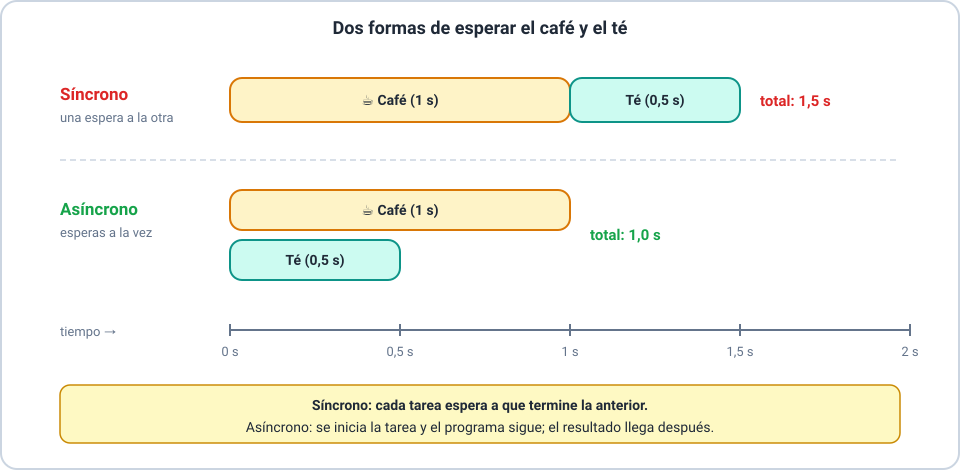
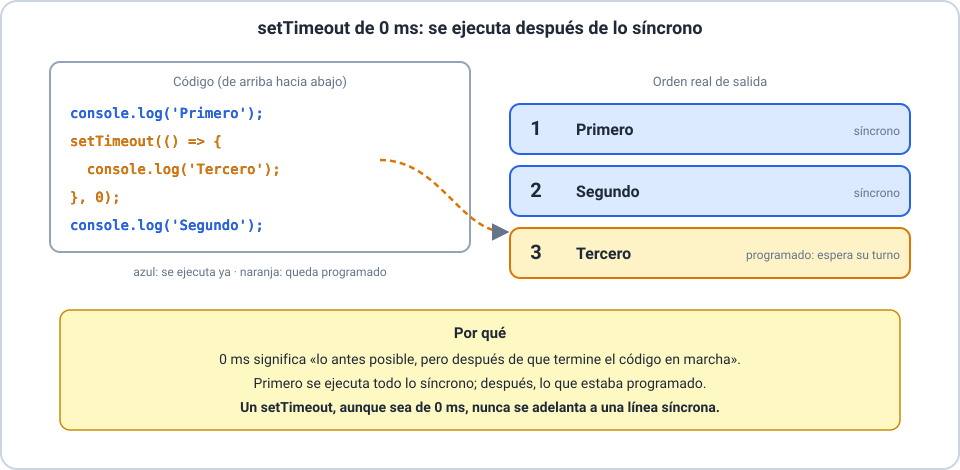

# ⏳ Asincronía y no bloqueo

Curso **JavaScript** · Clase 04 · **Sesión 1**

---

## 🎯 Objetivos de la sesión

- 🔹 Distinguir tareas síncronas y asíncronas.
- 🔹 Explicar qué es bloquear y por qué JavaScript no bloquea.
- 🔹 Predecir el **orden** en que salen los mensajes de un programa con temporizadores.

---

## ⏳ ¿Qué es la asincronía?



- **Síncrono:** cada tarea espera a la anterior.
- **Asíncrono:** se inicia la tarea y el programa **sigue**; el resultado llega después.

---

## 📏 Síncrono: todo en fila

- El orden de ejecución es el orden de escritura.
- Es lo que usaste en las Clases 01 a 03.
- Previsible, pero **cada espera detiene todo**.

---

## ⏲️ Asíncrono: `setTimeout`

```js
console.log('1. Lucía pide un café');
setTimeout(() => console.log('3. ☕ Listo'), 1000);
console.log('2. Lucía se sienta a esperar');
```

- La salida es **1, 2, 3**: el temporizador no detiene el programa.

---

## 🔢 El orden con `setTimeout`



- Un `setTimeout`, **aunque sea de 0 ms**, se ejecuta después del código síncrono.

---

## 🚧 Bloqueante frente a no bloqueante


- **Bloqueante:** el programa espera y la página se congela.
- **No bloqueante:** la espera la gestiona el navegador.

---

## 🧱 Un bucle largo bloquea todo

- Mientras un bucle trabaja, **nada más se ejecuta**: ni clics ni temporizadores.
- Un temporizador listo espera a que el código en marcha termine.
- Conviene **no ocupar el hilo** con tareas largas.

---

## 🧵 Un solo hilo

- Tu código se ejecuta **de a una tarea**, completa, en orden de llegada.
- Las tareas listas se **turnan**: no se mezclan.
- Las esperas (tiempo, red, clics) las gestiona el navegador.

---

## 🔁 Pila, cola y bucle de eventos


- Primero se vacía la **pila**; después el bucle toma la primera tarea de la **cola**.

---

## 🎯 Predecí el orden

```js
console.log('1');
setTimeout(() => console.log('2'), 300);
setTimeout(() => console.log('3'), 0);
setTimeout(() => { console.log('4'); setTimeout(() => console.log('5'), 0); }, 100);
console.log('6');
```

- Anotá **cuándo vence** cada temporizador. ¿Qué orden sale?

---

## ⚖️ ¿Cómo atendés vos?

- **Bloqueante:** te quedás esperando cada café.
- **No bloqueante:** tomás el pedido, seguís con el próximo y avisás.
- JavaScript elige **no bloquear** en sus esperas.

---

## ✍️ Actividad

- 🟢 [Básico 01](../ejercicios/basico-01.md), 🟡 [Intermedio 01](../ejercicios/intermedio-01.md) e 🟡 [Intermedio 02](../ejercicios/intermedio-02.md).
- 🛠️ [Taller 01 — El pedido que no espera](../../actividades/talleres/taller-01.md).

---

## ✅ Resumen

- Síncrono = en fila; asíncrono = el resultado llega después.
- Bloquear = ocupar el hilo; JavaScript no bloquea en sus esperas.
- Orden: primero lo síncrono, después la cola, por tiempo.
