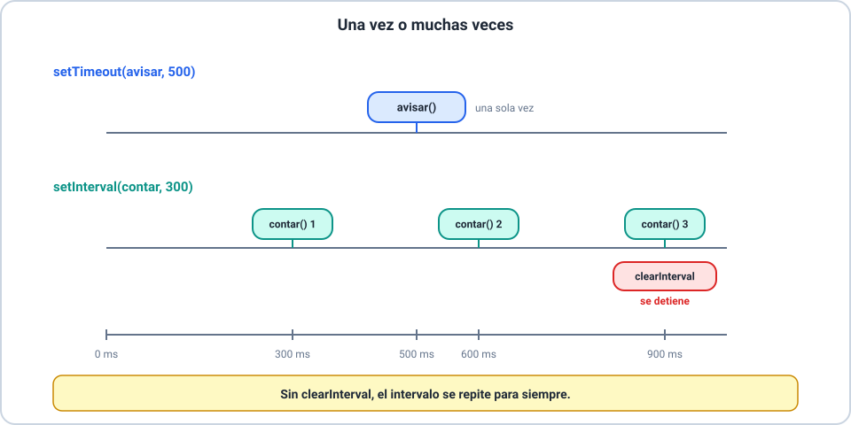

# 📞 Callbacks y tareas asíncronas

Curso **JavaScript** · Clase 04 · **Sesión 2**

---

## 🎯 Objetivos de la sesión

- 🔹 Escribir y usar funciones **callback**.
- 🔹 Programar tareas con `setTimeout`, `setInterval` y eventos.
- 🔹 Recibir resultados y errores con callbacks y encadenar pasos.

---

## 📞 ¿Qué es un callback?

- Una **función que se pasa como argumento** a otra, para que esta la llame después.
- Las funciones son **valores**: se guardan y se pasan.

```js
function aplicar(texto, transformar) { return transformar(texto); }
aplicar('café', (t) => t.toUpperCase());
```

---

## ⚠️ `f` o `f()`

- `setTimeout(f, 500)` → **entrega** la función.
- `setTimeout(f(), 500)` → la **ejecuta ya** y entrega su resultado.
- Si se espera un callback y no llega: `TypeError: callback is not a function`.

---

## 🔀 Síncrono frente a asíncrono

| | Síncrono | Asíncrono |
|---|---|---|
| Se ejecuta | Durante la llamada | Después, cuando ocurre algo |
| Ejemplo | `forEach` | `setTimeout`, clic |
| Orden de salida | El de escritura | Puede ser distinto |

---

## 🧭 Quién llama al callback


---

## ⏲️ Temporizadores



- `setTimeout` → una vez; `clearTimeout(id)` lo cancela.
- `setInterval` → repite; `clearInterval(id)` lo detiene.

---

## 🖱️ Eventos

- `boton.addEventListener('click', f)` **registra** el callback.
- El navegador lo llama **cada vez** que hay un clic, no al registrarlo.

---

## 📬 El resultado llega al callback

- Una función asíncrona **no devuelve** el resultado: lo **entrega** al callback.
- Fuera del callback, todavía es `undefined`.
- Todo lo que dependa del resultado va **dentro**.

---

## ❌ Error primero


- `callback(error, resultado)`: revisá primero el error y salí con `return`.
- El callback se llama **una sola vez**.

---

## 🪜 Encadenar y el infierno de callbacks


- Un paso dentro de otro: el código baja hacia la derecha.

---

## 🏷️ Funciones con nombre

- Un nombre por paso: `alValidar`, `alCobrar`, `alPreparar`…
- Se lee de arriba hacia abajo y los errores se atienden en cada una.
- Más adelante: las **promesas** y `async`/`await` simplifican esto.

---

## ✍️ Actividad

- 🟢 [Básico 02](../ejercicios/basico-02.md), 🟡 [Intermedio 03](../ejercicios/intermedio-03.md), 🔴 [Desafío 01](../ejercicios/desafio-01.md) y 🔴 [Desafío 02](../ejercicios/desafio-02.md).
- 🛠️ [Taller 02 — Del pedido a la entrega](../../actividades/talleres/taller-02.md).

---

## ✅ Resumen

- Callback = función pasada para que otra la llame después.
- Temporizadores y eventos son las fuentes de asincronía.
- «Error primero» y funciones con nombre mantienen el código claro.
