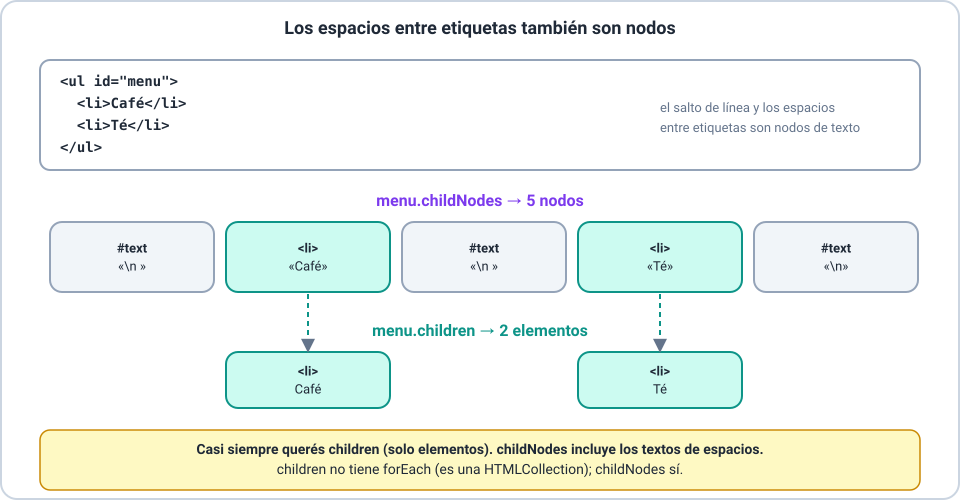

# 📚 Explicación conceptual — Manipulación avanzada del DOM mediante la jerarquía de elementos

En la Clase 06 aprendiste a **encontrar** elementos y a **cambiar** sus atributos, clases y contenido. En este módulo das tres pasos más: **crear** elementos nuevos y ponerlos en la página (aunque no estén en el HTML), **moverte por la jerarquía** (del botón a su tarjeta, de un elemento a su hermano) y **animar** los cambios para que se vean graduales. Los ejemplos siguen con la tienda ficticia **«Aroma»**: menús, tarjetas, avisos y listas de pedidos.

La clase se dicta en **tres sesiones**: la **sesión 1** cubre la administración de nodos y las propiedades de modificación (secciones 1.1 y 1.2); la **sesión 2**, la inserción adyacente y la navegación por la jerarquía (secciones 1.3 y 2); y la **sesión 3**, la animación (sección 3) y el proyecto de cierre.

Resultados de aprendizaje de la clase:

- **RA-1**: crear elementos y nodos de texto, y explicar la diferencia con `innerHTML`.
- **RA-2**: insertar, mover, copiar, reemplazar y eliminar nodos.
- **RA-3**: modificar un elemento con sus propiedades y leer el estilo calculado.
- **RA-4**: insertar contenido en una posición exacta con `insertAdjacent…`.
- **RA-5**: explicar el riesgo de insertar HTML de otra persona y aplicar la alternativa segura.
- **RA-6**: navegar la jerarquía y distinguir nodos de elementos.
- **RA-7**: animar con una clase y una transición de CSS, y con `style`.
- **RA-8**: animar con `requestAnimationFrame` y con `Element.animate()`.
- **RA-9**: aplicar buenas prácticas de animación y combinar creación, navegación y animación.

## 🗒️ Glosario

| Término | Equivalente |
|---|---|
| *node* / *element* / *text node* | nodo / elemento (nodo de etiqueta) / nodo de texto |
| *parent* / *child* / *sibling* | padre / hijo / hermano |
| *ancestor* | ancestro: el padre, el abuelo… |
| *detached* | desconectado: fuera de la página (sin padre) |
| *clone* | clon: copia de un nodo |
| *inline style* / *computed style* | estilo en línea / estilo calculado |
| *transition* | transición: cambio gradual entre dos estilos |
| *keyframe* | cuadro clave: un estado por el que pasa la animación |
| *frame* | cuadro: cada dibujado de la pantalla |
| *reflow* | reflujo: recalcular la posición y el tamaño de los elementos |

> 📌 **Origen de la información.** El resultado de **todos** los ejemplos se obtuvo **ejecutando el código en el navegador** (Chrome). Los de animación se ejecutaron **en tiempo real** (el tiempo virtual de la herramienta no ejecuta animaciones) y se verifican con **estados y eventos**, no con milisegundos ni cantidad de cuadros. **No se contrastó con otro motor**; las descripciones siguen la terminología de MDN Web Docs y las especificaciones DOM, CSS y Web Animations. Los **mensajes de error** aparecen en **inglés**, porque así los entrega el navegador; el texto los traduce.
>
> 👀 **La consola real y los elementos.** La consola de DevTools muestra los elementos como un árbol que se despliega; los ejemplos imprimen textos concretos y `outerHTML`.
>
> 🛡️ **Seguridad.** Los ejemplos de HTML inseguro usan **solo una marca inofensiva** (`window.hackeado = true`). Con texto de otra persona: nodos con `textContent`, `insertAdjacentText` o `setHTML()` (Clase 06; disponibilidad limitada).
>
> 🚫 **Lo que queda para más adelante.** No usamos delegación de eventos, formularios, `fetch`, `<template>`, *Shadow DOM*, `MutationObserver`, arrastrar y soltar, `canvas`, bibliotecas de animación ni clases.

---

## 🧱 Administración de nodos

### 🧭 1.1.1 · Inserción de elementos en el DOM — Administración de nodos: crear

*Resultados de aprendizaje: RA-1*

> 🔗 **Ejemplos de este concepto**
>
> - [Ejemplo 01 — Crear un elemento y agregarlo a la página](01-crear-un-elemento.md): `createElement`, `textContent` y `append`
> - [Ejemplo 02 — createTextNode: un nodo de texto](02-crear-un-nodo-de-texto.md): `createTextNode`
> - [Ejemplo 08 — Crear nodos frente a escribir HTML](08-crear-nodos-frente-a-inner-html.md): crear nodos frente a `innerHTML`

#### 🌍 Contexto

Hasta ahora, todo lo que mostrabas ya estaba en el HTML. Para mostrar datos nuevos (un producto agregado, un aviso) hay que **crear** elementos con JavaScript.

#### 💡 Concepto

`document.createElement(etiqueta)` crea un elemento **vacío y fuera de la página**; `document.createTextNode(texto)` crea un **nodo de texto**.

#### 📖 Explicación

- **Un elemento creado no está en la página:** su `parentNode` es `null` y `isConnected` es `false`.
- **Se configura antes de insertar:** texto, clase, atributos (Sección 1.2).
- **Los textos también son nodos** (`#text`, tipo `3`).
- **Crear nodos no interpreta HTML:** el texto con etiquetas se muestra como texto; `innerHTML` sí interpreta (Ejemplo 08).
- **El archivo `.html` no cambia:** lo que cambia es el DOM.

**Qué hace cada método de nodos:**

| Método | Qué hace | Devuelve |
|---|---|---|
| `createElement(etiqueta)` | crea un elemento fuera de la página | el elemento |
| `createTextNode(texto)` | crea un nodo de texto | el nodo |
| `append(…)` / `prepend(…)` | inserta dentro, al final / al principio (nodos y textos) | nada |
| `before(…)` / `after(…)` | inserta antes / después del elemento | nada |
| `appendChild(nodo)` / `insertBefore(nodo, ref)` | inserta (o **mueve**) un nodo | el nodo |
| `cloneNode(profundo)` | copia un nodo (el clon no está en la página) | el clon |
| `replaceWith(…)` / `replaceChild(nuevo, viejo)` | reemplaza un nodo | nada / el reemplazado |
| `remove()` / `removeChild(hijo)` | quita un nodo de la página | nada / el nodo quitado |

### 🧭 1.1.2 · Administración de nodos: insertar y mover

*Resultados de aprendizaje: RA-2*

> 🔗 **Ejemplos de este concepto**
>
> - [Ejemplo 03 — prepend, before y after](03-prepend-before-y-after.md): `prepend`, `before`, `after` y `append`
> - [Ejemplo 04 — Insertar un nodo existente lo mueve](04-mover-un-nodo-existente.md): insertar un nodo existente lo mueve
> - [Ejemplo 13 — Armar una tarjeta de producto](13-tarjeta-de-producto.md): crear, configurar e insertar una tarjeta

#### 🌍 Contexto

Un elemento nuevo hay que ponerlo en algún lugar: al final, al principio, antes o después de otro.

#### 💡 Concepto

Los métodos de inserción ponen un nodo en el árbol; si el nodo **ya estaba** en la página, **se mueve** en lugar de copiarse.

#### 📖 Explicación

- **`append` y `prepend`** insertan **dentro** (al final y al principio); **`before` y `after`**, **junto** al elemento. Aceptan varios nodos y textos.
- **`appendChild` e `insertBefore`** insertan un solo nodo y lo **devuelven**.
- **Insertar un nodo existente lo mueve:** no puede estar en dos lugares a la vez (Ejemplo 04).
- **Para tener una copia,** clonar primero.
- **MDN recomienda `append`** cuando el padre es un elemento.

### 🧭 1.1.3 · Administración de nodos: copiar

*Resultados de aprendizaje: RA-2*

> 🔗 **Ejemplos de este concepto**
>
> - [Ejemplo 05 — cloneNode: copiar un nodo](05-clonar-nodos.md): `cloneNode(false)` y `cloneNode(true)`

#### 🌍 Contexto

A veces querés otro elemento **igual** al existente, sin armarlo de nuevo.

#### 💡 Concepto

`nodo.cloneNode(profundo)` devuelve una **copia**: sin hijos si `profundo` es `false` (o falta) y con todos sus hijos si es `true`.

#### 📖 Explicación

- **El clon no está en la página** (sin padre) hasta que lo insertás.
- **Cambiale el `id`** antes de insertarlo: dos elementos con el mismo `id` rompen `getElementById`.
- **Insertar el mismo clon dos veces** no lo duplica: lo mueve.
- **Los controladores puestos con `addEventListener` no se copian;** los atributos `onclick="…"` del HTML, sí.

### 🧭 1.1.4 · Administración de nodos: reemplazar y eliminar

*Resultados de aprendizaje: RA-2*

> 🔗 **Ejemplos de este concepto**
>
> - [Ejemplo 06 — replaceWith y replaceChild](06-reemplazar-nodos.md): `replaceWith` y `replaceChild`
> - [Ejemplo 07 — remove y removeChild](07-eliminar-nodos.md): `remove` y `removeChild`
> - [Ejemplo 24 — Quitar una tarea con closest](24-borrar-con-closest.md): quitar un pedido con su botón

#### 🌍 Contexto

Los productos se agotan y los avisos se cierran: hay que cambiar o quitar elementos.

#### 💡 Concepto

`replaceWith` reemplaza un nodo por otro; `remove` lo quita de la página. Los equivalentes desde el padre son `replaceChild` y `removeChild`.

#### 📖 Explicación

- **El nodo quitado o reemplazado queda guardado en la variable,** pero su `parentNode` es `null`.
- **Un nodo quitado se puede volver a insertar** con su contenido.
- **`remove()` sobre un nodo que ya no está** no da error; `removeChild` sí si no es hijo de ese padre.
- **`replaceChild` recibe primero el nuevo y después el viejo.**

---

## 🏷️ Propiedades para la modificación de elementos

### 🧭 1.2.1 · Propiedades para modificación: id, className, title, hidden y disabled

*Resultados de aprendizaje: RA-3*

> 🔗 **Ejemplos de este concepto**
>
> - [Ejemplo 09 — Configurar un elemento: id, className, title, hidden y disabled](09-propiedades-id-class-name-title.md): configurar un elemento recién creado
> - [Ejemplo 13 — Armar una tarjeta de producto](13-tarjeta-de-producto.md): la tarjeta de producto

#### 🌍 Contexto

Un elemento nuevo está vacío: hay que darle identidad, clase y comportamiento antes de mostrarlo.

#### 💡 Concepto

Asignar una **propiedad** del elemento (`id`, `className`, `title`, `hidden`, `disabled`) **escribe el atributo HTML** correspondiente.

#### 📖 Explicación

- **`className`** es el texto completo de `class`; para clases sueltas, `classList` (Clase 06).
- **Las booleanas** (`hidden`, `disabled`) se asignan con `true` o `false`.
- **Se configura antes de insertar** para que el elemento aparezca listo.

### 🧭 1.2.2 · Propiedades para modificación: src, href y dataset

*Resultados de aprendizaje: RA-3*

> 🔗 **Ejemplos de este concepto**
>
> - [Ejemplo 10 — src, href y dataset](10-propiedades-src-href-y-dataset.md): imágenes, enlaces y datos propios

#### 🌍 Contexto

Las imágenes y los enlaces necesitan sus atributos, y cada producto necesita guardar sus datos (precio, código).

#### 💡 Concepto

`src`, `alt` y `href` configuran imágenes y enlaces; **`dataset`** guarda datos propios en atributos `data-…`.

#### 📖 Explicación

- **`dataset.precio`** escribe `data-precio`; los nombres compuestos van en *camelCase* (`productoId` → `data-producto-id`).
- **Los valores son siempre texto:** convertilos con `Number` para calcular.
- **El dato queda en el HTML,** visible para el CSS y otros scripts.

### 🧭 1.2.3 · Propiedades para modificación: style

*Resultados de aprendizaje: RA-3*

> 🔗 **Ejemplos de este concepto**
>
> - [Ejemplo 11 — La propiedad style (en camelCase)](11-propiedad-style.md): `style` en *camelCase* y el error con guion

#### 🌍 Contexto

Para cambiar un estilo puntual sin tocar el CSS existe la propiedad `style`.

#### 💡 Concepto

`elemento.style` permite leer y cambiar el **estilo en línea**; las propiedades CSS con guion se escriben en ***camelCase***.

#### 📖 Explicación

- **`backgroundColor`, `fontSize`…:** `style.background-color` da `SyntaxError` (se lee como una resta).
- **Con corchetes** se puede usar el nombre con guion: `style['background-color']`.
- **`style.cssText`** reemplaza todo el estilo en línea; asignar `''` quita una propiedad.
- **Mejor una clase:** cambiar clases (Clase 06) deja el aspecto en el CSS.

### 🧭 1.2.4 · Propiedades para modificación: estilo calculado

*Resultados de aprendizaje: RA-3*

> 🔗 **Ejemplos de este concepto**
>
> - [Ejemplo 12 — Estilo en línea y estilo calculado](12-estilo-en-linea-y-calculado.md): `style` frente a `getComputedStyle`

#### 🌍 Contexto

Una clase de CSS define el color, pero `style.color` devuelve vacío: ¿cómo saber el valor que realmente se aplica?

#### 💡 Concepto

`getComputedStyle(elemento)` devuelve el **estilo final aplicado**; `elemento.style` solo ve el estilo **en línea**.

#### 📖 Explicación

- **El estilo en línea gana a la clase:** al vaciarlo vuelve el de la clase.
- **`getComputedStyle` es de solo lectura** y da valores normalizados (`rgb(…)`).
- **También da valores no escritos** (`display` de un `
` es `block`).
- **Leerlo obliga al navegador a calcular los estilos:** lo usamos en las transiciones (Ejemplo 26).

---

## 📍 Inserción adyacente

### 🧭 1.3.1 · Propiedades de inserción adyacente: insertAdjacentElement

*Resultados de aprendizaje: RA-4*

> 🔗 **Ejemplos de este concepto**
>
> - [Ejemplo 14 — insertAdjacentElement: las cuatro posiciones](14-insert-adjacent-element.md): las cuatro posiciones
> - [Ejemplo 18 — Elegir dónde y cómo insertar](18-elegir-donde-insertar.md): elegir dónde insertar y el elemento sin padre

#### 🌍 Contexto

`append` y `prepend` solo insertan dentro; para insertar antes o después con la misma herramienta hay una forma con cuatro posiciones.

#### 💡 Concepto

`elemento.insertAdjacentElement(posición, nuevo)` inserta en `beforebegin`, `afterbegin`, `beforeend` o `afterend` y devuelve el elemento insertado (o `null`).

#### 📖 Explicación

- **`beforebegin` / `afterend`:** afuera, antes y después del elemento (necesitan un padre).
- **`afterbegin` / `beforeend`:** dentro, antes del primer hijo y después del último.
- **La posición no distingue mayúsculas;** una inválida lanza `SyntaxError`.
- **Sin padre,** `insertAdjacentElement('beforebegin', …)` devuelve `null`.

**Las cuatro posiciones:**

| Posición | Dónde queda el nodo |
|---|---|
| `beforebegin` | antes del elemento (afuera) |
| `afterbegin` | dentro, antes del primer hijo |
| `beforeend` | dentro, después del último hijo |
| `afterend` | después del elemento (afuera) |

### 🧭 1.3.2 · Propiedades de inserción adyacente: insertAdjacentText

*Resultados de aprendizaje: RA-4, RA-5*

> 🔗 **Ejemplos de este concepto**
>
> - [Ejemplo 15 — insertAdjacentText: texto sin interpretar](15-insert-adjacent-text.md): texto sin interpretar
> - [Ejemplo 17 — insertAdjacentHTML y su riesgo](17-insert-adjacent-html-y-su-riesgo.md): la opción segura

#### 🌍 Contexto

Cuando solo hay que insertar un texto en una posición exacta.

#### 💡 Concepto

`elemento.insertAdjacentText(posición, texto)` inserta un **nodo de texto**, **sin interpretar** etiquetas.

#### 📖 Explicación

- **Las etiquetas quedan escritas como texto** (escapadas).
- **No devuelve valor.**
- **Es la alternativa segura** a `insertAdjacentHTML` con texto de otra persona.

### 🧭 1.3.3 · Propiedades de inserción adyacente: insertAdjacentHTML y su riesgo

*Resultados de aprendizaje: RA-4, RA-5*

> 🔗 **Ejemplos de este concepto**
>
> - [Ejemplo 16 — insertAdjacentHTML: HTML en una posición](16-insert-adjacent-html.md): HTML en una posición
> - [Ejemplo 17 — insertAdjacentHTML y su riesgo](17-insert-adjacent-html-y-su-riesgo.md): el riesgo con una marca inofensiva
> - [Ejemplo 18 — Elegir dónde y cómo insertar](18-elegir-donde-insertar.md): `NoModificationAllowedError` sin padre

#### 🌍 Contexto

Para insertar HTML **propio** en una posición exacta, sin reemplazar lo que ya hay.

#### 💡 Concepto

`elemento.insertAdjacentHTML(posición, html)` **interpreta** el texto como HTML y lo inserta; **no sanea** nada.

#### 📖 Explicación

- **No reescribe lo existente** (a diferencia de `innerHTML +=`).
- **Con texto de otra persona es un riesgo (XSS):** `` ejecuta código (Ejemplo 17).
- **Alternativas:** `insertAdjacentText`, nodos con `textContent` o `setHTML()` (Clase 06, disponibilidad limitada).
- **Sin padre,** `beforebegin` y `afterend` lanzan `NoModificationAllowedError`.

---

## 🌳 Navegación de elementos en el DOM

### 🧭 2.1 · Navegación de elementos en el DOM — El padre

*Resultados de aprendizaje: RA-6*

> 🔗 **Ejemplos de este concepto**
>
> - [Ejemplo 19 — El padre: parentNode y parentElement](19-parent-node-y-parent-element.md): `parentNode` y `parentElement`

#### 🌍 Contexto

Desde un elemento recibido (por ejemplo, el de un clic) hace falta llegar a lo que lo rodea sin buscarlo por `id`.

#### 💡 Concepto

`parentNode` devuelve el **padre** de un nodo; `parentElement`, el padre **si es un elemento**.

#### 📖 Explicación

- **Un nodo sin padre** (recién creado o quitado) da `null`.
- **El padre de `<html>`** es `document`: su `parentNode` es `#document` y su `parentElement`, `null`.
- **Subir con `parentNode` varias veces** es frágil: para un ancestro, `closest`.

### 🧭 2.2 · Navegación: hijos, nodos y elementos

*Resultados de aprendizaje: RA-6*

> 🔗 **Ejemplos de este concepto**
>
> - [Ejemplo 20 — children frente a childNodes: elementos y nodos](20-children-y-child-nodes.md): `children` frente a `childNodes`
> - [Ejemplo 23 — Recorrer children sin romper la lista](23-recorrer-children-sin-romper.md): recorrer sin romper

#### 🌍 Contexto

Sofía contó dos productos con `children` y cinco nodos con `childNodes`: la diferencia son los espacios entre etiquetas.

#### 💡 Concepto

`children` trae los **elementos** hijos; `childNodes`, **todos los nodos** (incluidos los de texto de espacios).

#### 📖 Explicación

- **Los saltos de línea del HTML son nodos de texto.**
- **Casi siempre querés `children`.**
- **`children` no tiene `forEach`;** se recorre con `for…of` o `Array.from`.

**Propiedades de navegación:**

| Propiedad | Devuelve |
|---|---|
| `parentNode` / `parentElement` | el padre / el padre si es elemento |
| `children` | los elementos hijos (`HTMLCollection` viva) |
| `childNodes` | todos los nodos hijos (`NodeList` viva) |
| `firstElementChild` / `lastElementChild` | el primer / último hijo elemento |
| `previousElementSibling` / `nextElementSibling` | el hermano anterior / siguiente |
| `closest(selector)` | el ancestro (o él mismo) que coincide, o `null` |

### 🧭 2.3 · Navegación: hermanos y extremos

*Resultados de aprendizaje: RA-6*

> 🔗 **Ejemplos de este concepto**
>
> - [Ejemplo 21 — Primer hijo, último hijo y hermanos](21-primero-ultimo-y-hermanos.md): primer hijo, último hijo y hermanos

#### 🌍 Contexto

Desde un producto, ir al anterior o al siguiente, o a los extremos de la lista.

#### 💡 Concepto

`firstElementChild`, `lastElementChild`, `previousElementSibling` y `nextElementSibling` navegan **por elementos**.

#### 📖 Explicación

- **En los extremos dan `null`.**
- **Las versiones sin «Element»** (`firstChild`, `nextSibling`) devuelven nodos, incluidos los textos de espacios.
- **Comprobá `null`** antes de usar el resultado.

### 🧭 2.4 · Navegación: closest

*Resultados de aprendizaje: RA-6*

> 🔗 **Ejemplos de este concepto**
>
> - [Ejemplo 22 — closest: del botón a su tarjeta](22-closest.md): del botón a su tarjeta
> - [Ejemplo 24 — Quitar una tarea con closest](24-borrar-con-closest.md): quitar un pedido

#### 🌍 Contexto

Con muchas tarjetas, cada botón tiene que encontrar **su** tarjeta, sin un `id` por botón.

#### 💡 Concepto

`elemento.closest(selector)` sube desde el elemento (incluido él) hasta el primer **ancestro** que coincide con el selector, o `null`.

#### 📖 Explicación

- **Más robusto que `parentNode.parentNode`:** sigue funcionando si se agrega un `
` en el medio.
- **Un solo código sirve para todas las tarjetas.**
- **Un selector inválido** lanza `SyntaxError`.

### 🧭 2.5 · Navegación: recorrer sin romper la lista

*Resultados de aprendizaje: RA-6*

> 🔗 **Ejemplos de este concepto**
>
> - [Ejemplo 23 — Recorrer children sin romper la lista](23-recorrer-children-sin-romper.md): `Array.from` y la colección viva

#### 🌍 Contexto

Marcos quiso borrar todos los productos con un bucle y quedaron la mitad.

#### 💡 Concepto

`children` y `childNodes` son **colecciones vivas**: modificarlas mientras se recorren salta elementos; se copian con `Array.from` antes.

#### 📖 Explicación

- **Al quitar el elemento `0`,** el `1` pasa a ser el `0`.
- **Recorré una copia** (`Array.from(elemento.children)`) cuando agregues o quites hijos.
- **`querySelectorAll`** (estática) evita el problema.

---

## 🎞️ Animación de elementos del DOM

### 🧭 3.1 · Animación de elementos del DOM — Transición con una clase

*Resultados de aprendizaje: RA-7*

> 🔗 **Ejemplos de este concepto**
>
> - [Ejemplo 25 — Una transición activada con una clase](25-transicion-con-clase.md): clase, `transitionend` y `getAnimations()`
> - [Ejemplo 27 — Una transición con la propiedad style](27-transicion-con-style.md): transición con `style`

#### 🌍 Contexto

Para que un cambio se vea gradual hay cuatro herramientas, de la más simple a la que más control da.

#### 💡 Concepto

Una **transición de CSS** anima el paso entre dos estilos; JavaScript solo **cambia una clase** y el navegador hace el movimiento.

#### 📖 Explicación

- **El CSS** define la propiedad, la duración y la curva (`transition: transform 400ms linear`) y el estado final (la clase).
- **`getAnimations()`** lista las animaciones del elemento (una `CSSTransition`); `finished` y **`transitionend`** avisan el final.
- **Animá `transform` y `opacity`:** el navegador las anima con menos esfuerzo que el tamaño o la posición.
- **Las animaciones se verifican con eventos y estados,** no a simple vista.

### 🧭 3.2 · Animación: por qué a veces no se anima

*Resultados de aprendizaje: RA-7*

> 🔗 **Ejemplos de este concepto**
>
> - [Ejemplo 26 — Por qué a veces no se anima](26-por-que-no-anima.md): sin leer el estado inicial no hay transición

#### 🌍 Contexto

Lucía agregó la clase y la caja saltó al final, sin animación.

#### 💡 Concepto

Una transición necesita que el navegador **vea el estado inicial** antes del cambio.

#### 📖 Explicación

- **Elementos recién creados** y cambios en la misma ejecución del script no tienen estado inicial calculado.
- **Leer `getComputedStyle(elemento).propiedad`** antes de cambiar lo garantiza.
- **Prueba rápida:** `elemento.getAnimations().length`.
- **Hay otras soluciones** (`@starting-style`, esperar un cuadro) que veremos más adelante.

### 🧭 3.3 · Animación: transición con style

*Resultados de aprendizaje: RA-7*

> 🔗 **Ejemplos de este concepto**
>
> - [Ejemplo 27 — Una transición con la propiedad style](27-transicion-con-style.md): `style.transition` y `opacity`

#### 🌍 Contexto

Cuando el valor se calcula en JavaScript (una posición, un porcentaje), no sirve una clase fija.

#### 💡 Concepto

`style.transition` define la transición desde JavaScript y un cambio de valor la dispara.

#### 📖 Explicación

- **Se lee el estilo calculado antes de cambiar el valor.**
- **Para aspectos fijos,** una clase deja el aspecto en el CSS.

### 🧭 3.4 · Animación: Element.animate()

*Resultados de aprendizaje: RA-8*

> 🔗 **Ejemplos de este concepto**
>
> - [Ejemplo 28 — Element.animate(): animar sin escribir CSS](28-element-animate.md): `animate()`, `playState` y `finished`
> - [Ejemplo 29 — Pausar, terminar y cancelar una animación](29-controlar-una-animacion.md): `pause`, `finish` y `cancel`
> - [Ejemplo 33 — Una tarjeta que aparece y se cierra con animación](33-tarjeta-que-aparece-y-se-cierra.md): una tarjeta que aparece y se cierra

#### 🌍 Contexto

Para animar sin escribir CSS, con control sobre la animación.

#### 💡 Concepto

`elemento.animate(cuadros, opciones)` crea y arranca una animación y devuelve un **`Animation`** con `playState`, `finished` y los controles `pause`, `play`, `finish` y `cancel`.

#### 📖 Explicación

- **`fill: 'forwards'`** conserva el último cuadro; sin él, el elemento vuelve al estado de partida.
- **`cancel()`** descarta la animación (y rechaza `finished`).
- **Para animar la salida,** esperá `finished` antes de `remove()` (Ejemplo 33).
- **Es una API estándar** y MDN la marca como ampliamente disponible.

### 🧭 3.5 · Animación: requestAnimationFrame

*Resultados de aprendizaje: RA-8*

> 🔗 **Ejemplos de este concepto**
>
> - [Ejemplo 30 — requestAnimationFrame: animar cuadro a cuadro](30-request-animation-frame.md): animar cuadro a cuadro

#### 🌍 Contexto

Para animaciones que dependen de cálculos (un juego, un gráfico) hay que mover el elemento en cada cuadro.

#### 💡 Concepto

`requestAnimationFrame(función)` ejecuta la función **antes del próximo dibujado**; hay que volver a pedirla para seguir animando.

#### 📖 Explicación

- **La función recibe una marca de tiempo:** calculá el avance con el tiempo transcurrido, no con un paso fijo.
- **`cancelAnimationFrame(id)`** cancela un cuadro pedido.
- **La cantidad de cuadros no es fija;** por eso solo se verifica el resultado final.
- **Solo si hace falta:** para lo simple, transiciones o `animate()`.

### 🧭 3.6 · Animación: @keyframes de CSS

*Resultados de aprendizaje: RA-7*

> 🔗 **Ejemplos de este concepto**
>
> - [Ejemplo 31 — Animación con @keyframes de CSS](31-animacion-con-keyframes-css.md): `@keyframes` y `animationend`

#### 🌍 Contexto

Para animaciones decorativas y repetidas (un latido, un giro).

#### 💡 Concepto

`@keyframes` define los cuadros en CSS y una clase con `animation` la activa; `animationend` avisa el final.

#### 📖 Explicación

- **No necesita estado inicial previo** (a diferencia de la transición).
- **`getAnimations()`** devuelve una `CSSAnimation` con su nombre.

### 🧭 3.7 · Animación: prefers-reduced-motion

*Resultados de aprendizaje: RA-9*

> 🔗 **Ejemplos de este concepto**
>
> - [Ejemplo 32 — Respetar prefers-reduced-motion](32-prefers-reduced-motion.md): detectar la preferencia y acortar la animación
> - [Ejemplo 33 — Una tarjeta que aparece y se cierra con animación](33-tarjeta-que-aparece-y-se-cierra.md): integrador

#### 🌍 Contexto

A algunas personas el movimiento les provoca mareos y lo piden en su sistema.

#### 💡 Concepto

`matchMedia('(prefers-reduced-motion: reduce)').matches` es `true` si la persona pidió **menos movimiento**.

#### 📖 Explicación

- **Evitá o acortá las animaciones** cuando es `true`.
- **También se puede resolver solo en CSS** con `@media (prefers-reduced-motion: reduce)`.
- **Buena práctica general:** animar `transform` y `opacity`, y respetar esta preferencia.
