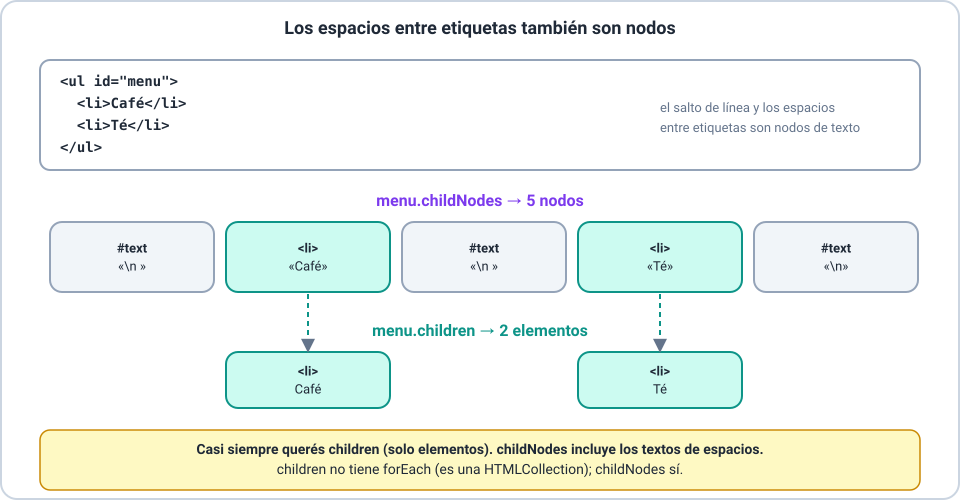

# 📍 Insertar con precisión y navegar

Curso **JavaScript** · Clase 07 · **Sesión 2**

---

## 🎯 Objetivos de la sesión

- 🔹 Insertar en una posición exacta con `insertAdjacent…`.
- 🔹 Navegar la jerarquía: padre, hijos y hermanos.
- 🔹 Distinguir nodos de elementos y usar `closest`.

---

## 📍 Las cuatro posiciones


- `beforebegin`, `afterbegin`, `beforeend`, `afterend`.

---

## ✍️ `insertAdjacentElement` e `insertAdjacentText`

- `insertAdjacentElement` devuelve el elemento (o `null` sin padre).
- `insertAdjacentText` inserta **texto**: no interpreta etiquetas.

---

## ⚠️ `insertAdjacentHTML`

- Interpreta HTML y **no sanea**: riesgo con texto de otra persona.
- Alternativas: `insertAdjacentText`, nodos con `textContent`, `setHTML()`.
- Sin padre, `beforebegin` / `afterend` → `NoModificationAllowedError`.

---

## 🌳 La jerarquía


---

## ⬆️ El padre

- `parentNode` y `parentElement`; `null` si no hay padre.
- El padre de `<html>` es `document` (no es un elemento).

---

## 🧩 Nodos frente a elementos



- `children` → solo elementos. `childNodes` → todos (con textos de espacios).

---

## ↔️ Hermanos y extremos

- `firstElementChild`, `lastElementChild`.
- `previousElementSibling`, `nextElementSibling`; `null` en los extremos.

---

## 🎯 `closest`

```js
boton.closest('.tarjeta');
```

- Sube hasta el primer ancestro (o él mismo) que coincide, o `null`.

---

## 🔁 Recorrer sin romper la lista

- `children` es **viva**: quitar mientras recorrés salta elementos.
- Copiá con `Array.from` antes de modificar.

---

## 🗑️ Quitar con `closest`

- Botón → `closest('li')` → `remove()`.
- Un solo código sirve para todos los elementos.

---

## ✍️ Actividad

- 🟢 [Básico 02](../ejercicios/basico-02.md), 🟡 [Intermedio 03](../ejercicios/intermedio-03.md), 🔴 [Desafío 01](../ejercicios/desafio-01.md).
- 🛠️ [Taller 02 — Moverse por la lista](../../actividades/talleres/taller-02.md).

---

## ✅ Resumen

- Cuatro posiciones; texto seguro, HTML solo propio.
- `children` para elementos; `closest` para ancestros.
