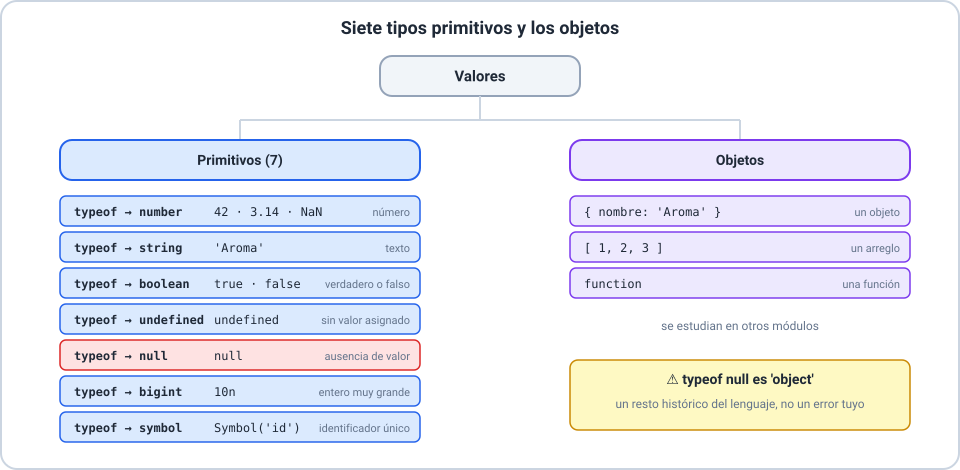

# 🟨 Introducción a JavaScript

Curso **JavaScript** · Clase 01 · **Sesión 1**

---

## 🎯 Objetivos de la sesión

- 🔹 Explicar qué es JavaScript y ejecutar el primer código.
- 🔹 Usar la consola y los dos modos de incorporar un script.
- 🔹 Conocer ECMAScript y los tipos de datos.
- 🔹 Declarar variables y constantes con criterio.

> 📌 No hace falta saber programar.

---

## 🟨 ¿Qué es JavaScript?


---

## ⌨️ La consola


---

## 📄 En línea y desde un archivo externo


---

## 🚦 El lugar del `<script>` importa

- El navegador lee la página **de arriba hacia abajo**.
- En el `<head>`, el título todavía **no existe**: `null`.
- Al final del `<body>`, el título **ya existe**.
- Un error se informa con su **archivo y su línea**.

---

## 🕰️ ECMAScript


---

## 🌐 Estrategia «crossbrowser»

1. **Consultar** la compatibilidad (MDN, *Baseline*).
2. **Detectar** con `typeof`: `typeof Number.isNaN`.
3. **Decidir** qué características usar.

> ⚠️ La sintaxis nueva no se detecta: si no se entiende, el script entero falla.

---

## 🏷️ Tipos de datos



---

## 📦 `var`, `let` y `const`


---

## 🔒 `const` no es «inmutable»

```js
const tienda = { nombre: 'Aroma' };
tienda.nombre = 'Aroma Centro';   // funciona
tienda = {};                      // TypeError
```

- `const` protege el **nombre**, no el contenido.
- Empezá con `const`; si cambia, `let`; evitá `var`.

---

## ⚠️ Errores comunes

- 🚫 Reasignar una `const`.
- 🚫 Redeclarar con `let`.
- 🚫 Usar una `let` antes de declararla.
- 🚫 Poner el script en el `<head>` y leer un elemento del `<body>`.

---

## 🛠️ Actividad

**Taller 01 — Mi primer programa en la consola.**

Y los ejercicios **Básico 01**, **Básico 02** e **Intermedio 01**.

---

## ✅ Resumen de la sesión

- 🔹 JavaScript = comportamiento; HTML = contenido; CSS = aspecto.
- 🔹 Consola para probar; `<script>` para incorporar.
- 🔹 ECMAScript es el estándar; comprobá la compatibilidad.
- 🔹 `const` por defecto, `let` si cambia.
