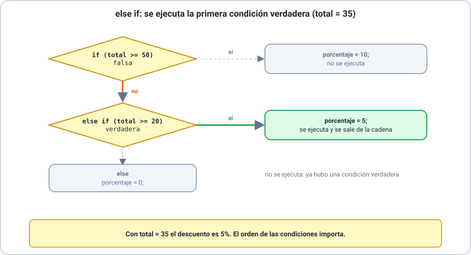
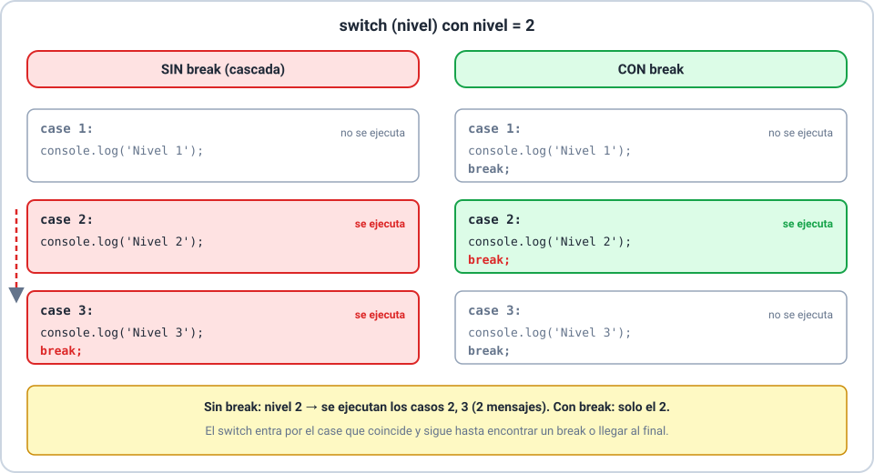
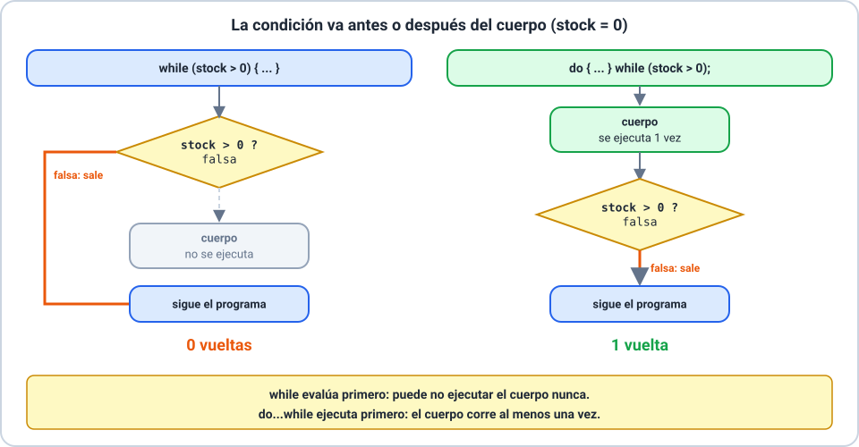

# 🔀 Condicionales y bucles

Curso **JavaScript** · Clase 02 · **Sesión 1**

---

## 🎯 Objetivos de la sesión

- 🔹 Decidir con `if`, `else if`, `else`, `switch` y `? :`.
- 🔹 Repetir con `while`, `do...while` y `for`.
- 🔹 Reconocer y evitar un bucle infinito.
- 🔹 Controlar un bucle con `break` y `continue`.

> 📌 Seguimos con la tienda «Aroma» de la Clase 01.

---

## 🔀 `if` y `else`

- Un `if` ejecuta su bloque **solo si** la condición es verdadera.
- `else` es el camino contrario: nunca se recorren los dos.

---

## 🪜 `else if`: varias condiciones

- Se evalúan **en orden** y se ejecuta la **primera** verdadera.
- El orden importa: de lo más específico a lo más general.

---

## ⚠️ Errores comunes con `if`

- `=` en lugar de `===`: **asigna** en vez de comparar.
- Un `;` después de la condición: el `if` queda vacío.
- Sin llaves, el `else` se engancha con el `if` más cercano.
- Valores **falsos**: `false`, `0`, `-0`, `0n`, `''`, `null`, `undefined` y `NaN`.

> 💡 Escribí siempre las llaves y comparaciones con `===`.

---

## 🎛️ `switch` y el operador `? :`

- `switch` compara con `===` y entra por el `case` que coincide.
- Sin `break`, sigue con los casos siguientes (cascada).
- `condición ? A : B` elige entre **dos valores**.

---

## 🔁 `while` y `do...while`

- `while` evalúa **antes**: puede no ejecutarse nunca.
- `do...while` evalúa **después**: se ejecuta al menos una vez.

---

## 🔢 El bucle `for`

- `for (inicio; condición; avance)`.
- `<` o `<=`: contá las vueltas a mano.

---

## ♾️ El bucle infinito

- La condición **nunca** se vuelve falsa: la pestaña se congela.
- Causas: olvidar el avance, avanzar en sentido contrario o `while (true)` sin salida.
- Antes de ejecutar, preguntate: **¿qué línea hace falsa la condición?**
- Mientras practicás, usá un **seguro** (un contador con tope).

---

## ✂️ `break` y `continue`

- `break`: «dejo de repetir».
- `continue`: «dejo esta vuelta y sigo con la próxima».

---

## 🛠️ Actividad de la sesión

- Ejercicios **Básico 01**, **Básico 02** e **Intermedio 01**.
- **Taller 01:** «El carrito de Aroma».
- Predecí antes de ejecutar y **no ejecutes** el bucle infinito de la Parte A.

---

## ✅ Resumen de la sesión 1

- 🔹 Decisiones: `if`/`else if`/`else`, `switch`, `? :`.
- 🔹 Repeticiones: `while`, `do...while`, `for`.
- 🔹 Un bucle necesita algo que haga falsa su condición.
- 🔹 `break` corta el bucle; `continue` salta una vuelta.

> 🔜 Sesión 2: funciones.
